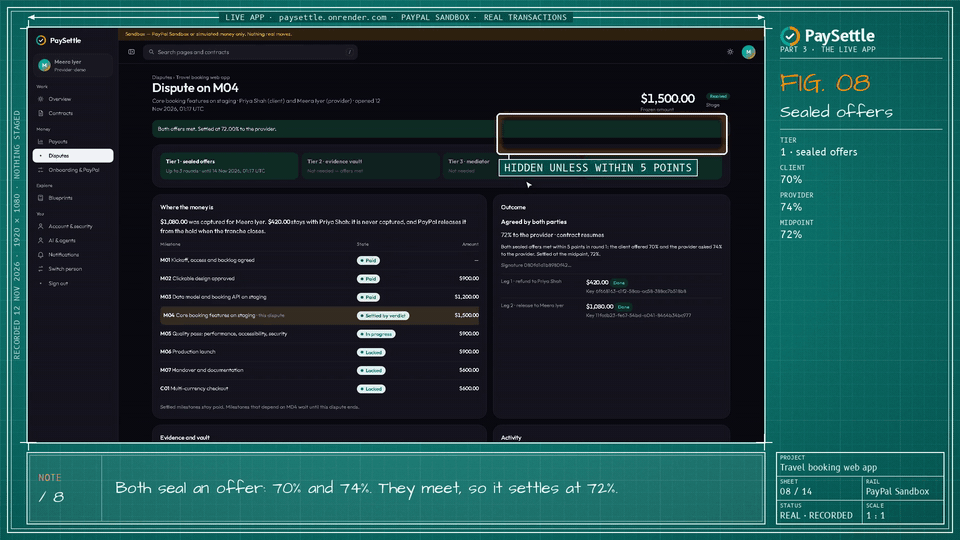
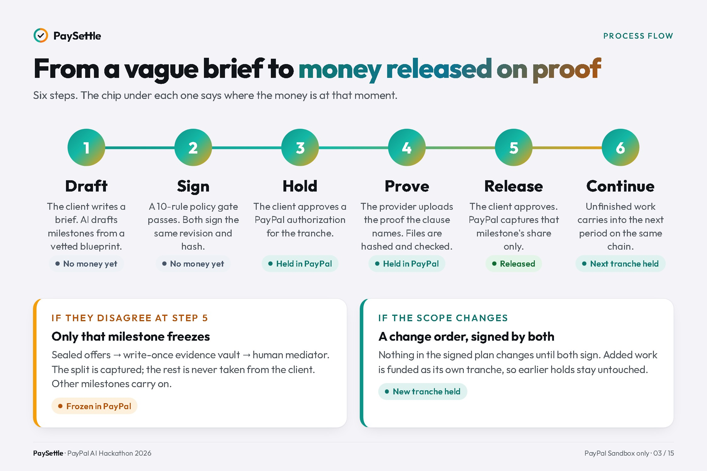
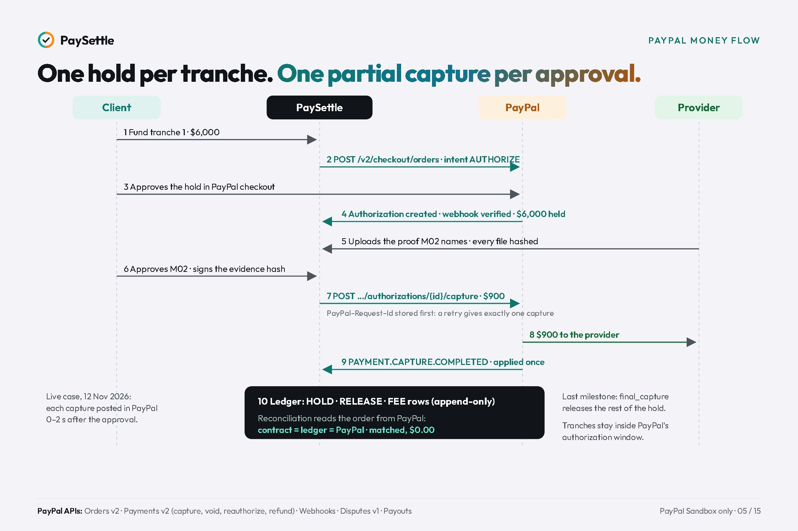
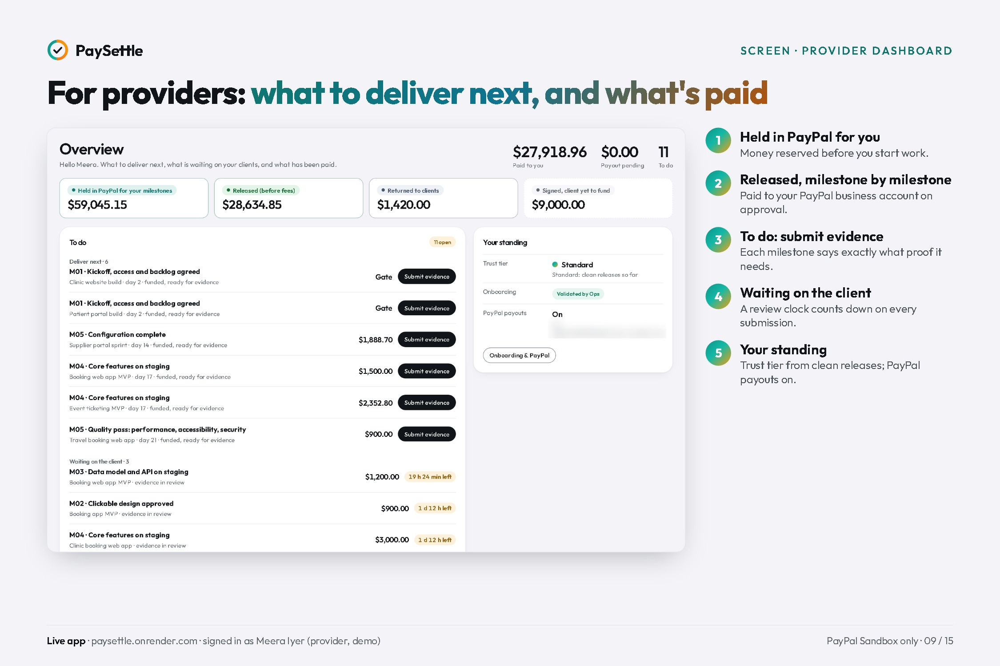
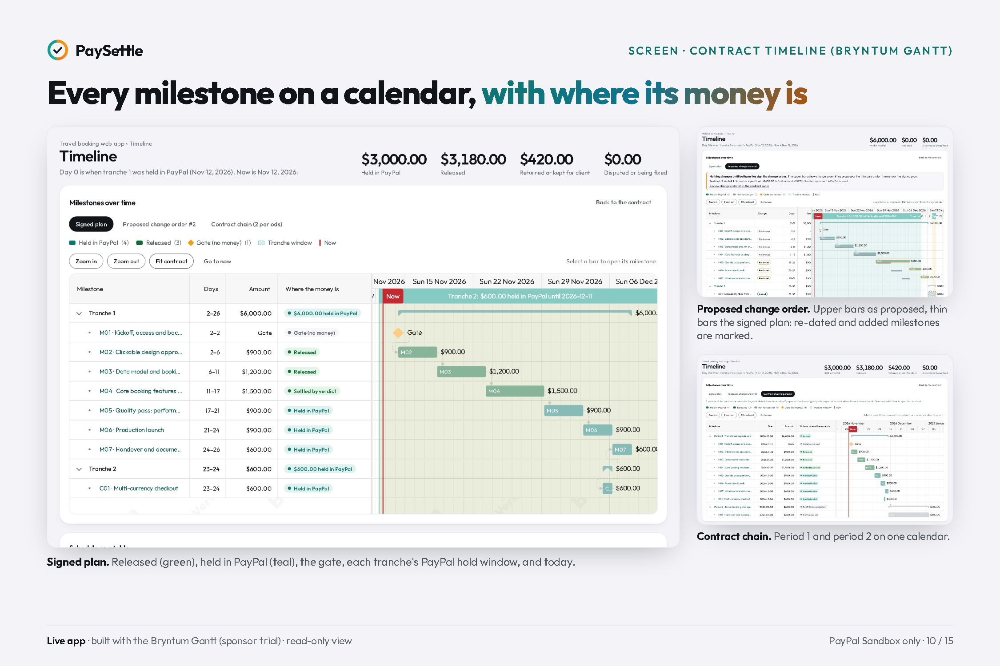
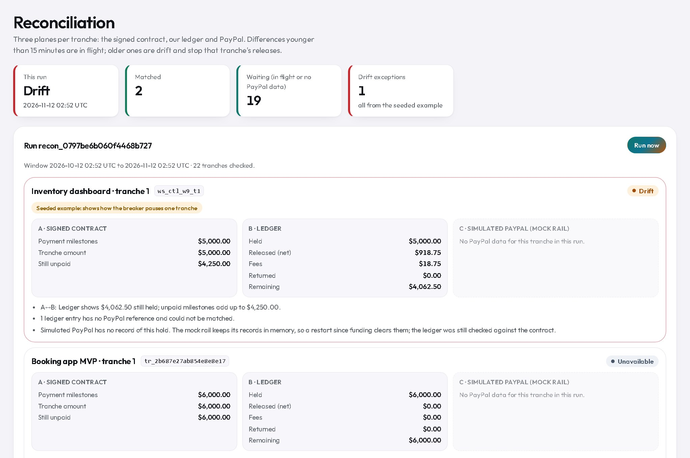
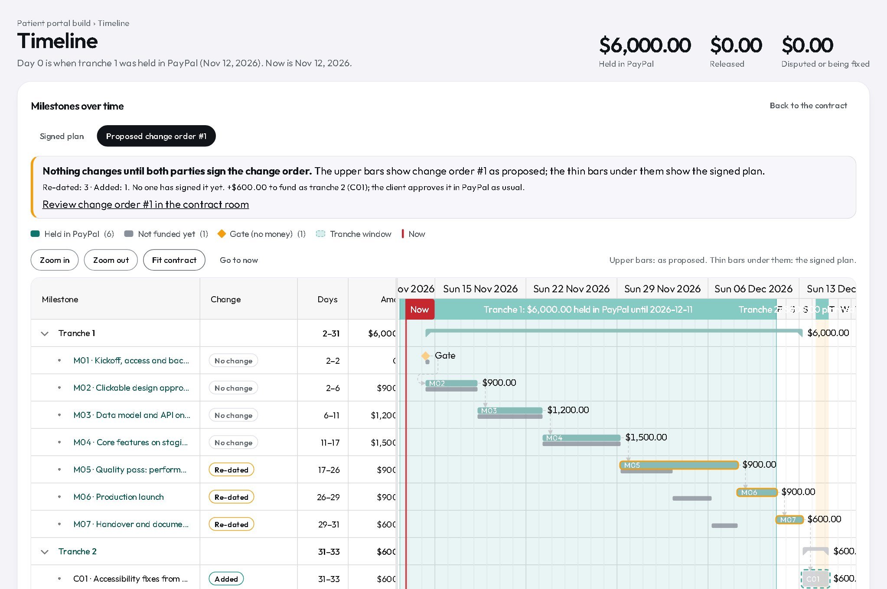
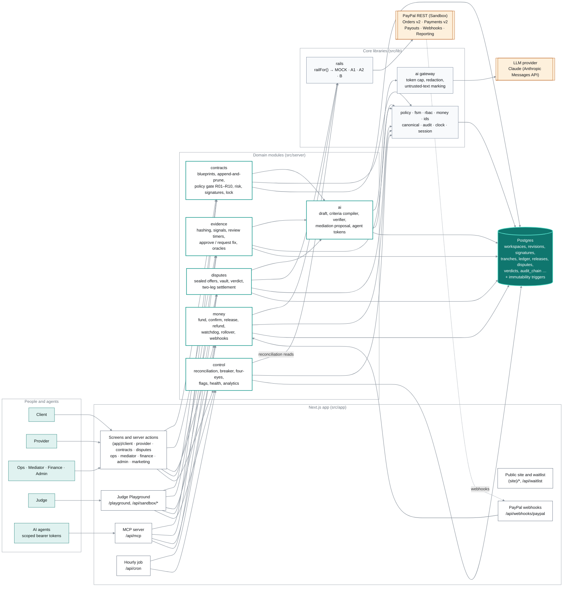
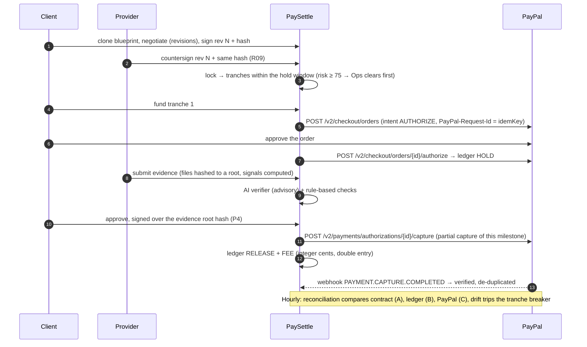

# PaySettle

[](https://github.com/swaasthsewa/paysettle/actions/workflows/ci.yml) [](LICENSE) [](https://paysettle.onrender.com) [](https://youtu.be/G4lLq1aySiY)

**Milestone contracts with the money held in PayPal. Agree what *done* means; get paid when it is.**

What PaySettle combines:

- **Any staged job, physical work included.** 20 vetted blueprints, from a web MVP to a kitchen fit-out, roofing, solar,
  events and travel, with proof to match: test reports, dated photos, inspection certificates.
- **A dispute pauses one stage and ends with a person, not an AI verdict.** Sealed offers first, then an evidence vault,
  then a human mediator (a second one co-signs above $5,000). The rest of the project carries on.
- **The whole life of a contract.** Change orders both sides sign, funded as their own hold; unfinished work continues into
  the next period on the same contract chain.
- **Every payment reconciled to the cent with PayPal's own records**, and [fooling the AI moves no money](https://swaasthsewa.github.io/paysettle/manuals/cheat.html).

**[▶ Watch the video (2:58)](https://youtu.be/G4lLq1aySiY)** · **[Live demo, no account](https://paysettle.onrender.com)** ·
[In 16 slides](https://swaasthsewa.github.io/paysettle/slides/) · [Role manuals](https://swaasthsewa.github.io/paysettle/manuals/) ·
[For sponsor judges](#for-sponsor-judges) · [AI agents](https://swaasthsewa.github.io/paysettle/manuals/agents.html) ·
[Measured results](RESULTS.md) · [How it works](docs/architecture.md) · [Run it in 3 commands](#run-it-in-3-commands-no-keys)



Built for the **PayPal AI Hackathon** (submission period 1 Oct – 12 Nov 2026). **PayPal Sandbox only: no real money
moves.** Parts reused from the author's earlier projects are listed in [`REUSE.md`](REUSE.md).

## Why this exists

Three things happened to the author:

- **A trip paid in advance.** The hotel at check-in was not the one booked, and the agency said the hotel decides. The
  money had already gone.
- **A client who paid late.** The work was signed off; the last payment took months of reminders.
- **A project that kept growing.** "Small" changes, none written down, all expected free, with the same deadline.

Each had a contract. None had a definition of done: nobody wrote down, in a way anyone could check, what finished meant,
what a change costs, or when the money moves. It is common, and it cuts both ways. In Remote's survey of 3,300
freelancers in 10 countries, 85% are paid late at least some of the time and only 15% are always paid on time; among
1,900 employers, 25% had freelancers miss deadlines
([Remote, *The State of Freelance Work 2025*](https://remote.com/resources/research/contractor-management-report),
pp. 4, 16, 21). PaySettle protects both sides: the client pays only for checked work, and the provider knows the money is
held before the work starts.

## What it does

Freelancers and small agencies are paid in stages, and most fights are about one question: *is this milestone done?*
PaySettle settles that question before any money moves.

1. **Draft.** The client writes a brief. The AI drafts milestones from a vetted blueprint, and the criteria compiler
   rejects taste words: “fast and modern” becomes “Lighthouse mobile score 85 or more on staging, report attached”.
2. **Sign.** Client and provider sign the same revision and hash. Nothing changes later unless both sign a change order.
3. **Hold.** The client approves a hold in PayPal: an authorization per tranche. The money stays in PayPal.
4. **Prove and release.** The provider uploads the proof the clause names. Files are hashed; rule checks and an AI
   verifier advise; the client decides. Approval makes a **partial capture** of that milestone's share only.
5. **Disagree on one milestone, not the project.** A dispute freezes one milestone's share. Sealed offers settle it in
   days when both sides are within 5 points; otherwise an evidence vault, then a mediator.
6. **Keep going.** Unfinished milestones carry over into the next period on the same contract chain; every PayPal
   event is signature-verified, and every tranche is reconciled to the cent across contract, ledger and PayPal.

## Gallery

| | |
|---|---|
| [](docs/gallery/slides/03-process-flow.jpg) | [](docs/gallery/slides/05-paypal-money-flow.jpg) |
| [](docs/gallery/slides/09-provider-dashboard.jpg) | [](docs/gallery/slides/10-gantt-timeline.jpg) |

**[All 40 images →](docs/gallery/README.md)**: 16 explainer slides (concept, block diagram, criteria compiler, disputes,
when to use it, how it differs, can it be cheated), 12 live-app screens, 10 frames from the video and the architecture diagrams.

## At a glance

| Measured | Result | Against | n | Source |
|---|---|---|---|---|
| A real case on the live app, PayPal Sandbox (12 Nov 2026) | $6,000 held; 3 partial captures ($900, $1,200, $1,080); a dispute settled at 72% | — | 1 contract, 2 tranches | [RESULTS.md](RESULTS.md#hosted-demo-and-paypal-sandbox) |
| PayPal posting time after the step in PaySettle | 0–2 s for each of the 4 money steps | — | 4 | [RESULTS.md](RESULTS.md#hosted-demo-and-paypal-sandbox) |
| Three-way reconciliation of that case | both tranches **matched**, $0.00 difference | contract, ledger, PayPal | 2 tranches | [RESULTS.md](RESULTS.md#hosted-demo-and-paypal-sandbox) |
| Unit and integration tests in public CI | 803 passed, 1 skipped | — | 66 files | [CI run 43242033869](https://github.com/swaasthsewa/paysettle/actions/runs/43242033869) |
| Cheat attempts: fooling the AI, forged webhooks, edited records | money moved without the signed decision: $0 | — | 18 | [Can it be cheated?](#can-it-be-cheated) |
| Requirements traced to code and tests | 65 / 65 | — | 65 | [CI run 43242033869](https://github.com/swaasthsewa/paysettle/actions/runs/43242033869) |
| End-to-end journeys (Playwright, with axe accessibility scans) | 54 / 54 | — | 54 | [RESULTS.md](RESULTS.md#gates) (11 Nov) |
| Criteria compiler: vague vs checkable | agreement 1.0 | plain one-prompt LLM: also 1.0 | 60 | [RESULTS.md](RESULTS.md#compiler-vs-plain-llm-npm-run-evalcompare-n--60) |
| Evidence verifier | agreement 0.813, **spoofed packages advised to approve: 0** | target 0.85 (**missed**) | 16 | [RESULTS.md](RESULTS.md#ai-golden-sets-npm-run-eval) |
| Prompt injection hidden in evidence | instructions followed: 0 | 0 | 12 | same |
| Mediation proposals within 10 points of the labelled split | 0.8 | target 0.8 | 10 | same |
| AI cost | about $0.012 a call | — | 43 calls | same |

## The real case, in PayPal

Recorded for the video on the live site, then checked in PayPal's own records. Times are IST; PayPal's Activity page
shows them in US Eastern time, the evening before.

| Step in PaySettle | PayPal | Amount | PaySettle | PayPal |
|---|---|---|---|---|
| Tranche 1 approved by the buyer | order `4AT27605L6365991Y`, authorization `4EP18648Y5694440C` | $6,000.00 held | 06:39:44 | 06:39:45 |
| M02 approved by the client | capture `0CH93334JW441980B` | $900.00 | 06:43:07 | 06:43:09 |
| Change order funded as tranche 2 | order `53E92477EN885981U`, authorization `81R51860WR7095409` | $600.00 held | 06:45:18 | 06:45:18 |
| M03 approved by the client | capture `55U67317S0232474M` | $1,200.00 | 06:46:15 | 06:46:16 |
| M04 dispute settled at 72% | capture `5CL88405R5549173G` | $1,080.00 to the provider; $420.00 never captured | 06:48:23 | 06:48:24 |

## PayPal APIs used

| API | What PaySettle does with it |
|---|---|
| Orders v2, `intent=AUTHORIZE` | One order per tranche; the buyer approves the hold in PayPal's checkout. On Rail A1 the provider is the payee. |
| Payments v2 · authorizations `capture` | One **partial capture** per approved milestone; `final_capture` on the last one releases the rest. |
| Payments v2 · `void`, `reauthorize`; captures `refund` | Returns, the end of the hold window, refunds on the custodial rails. |
| `PayPal-Request-Id` | A stored idempotency key on every money call: a retry after a 503 gives exactly one capture. |
| Webhooks + `verify-webhook-signature` | Every event verified and applied once (de-duplicated on transmission id); failures wait in a dead-letter queue. |
| Payments v2 · orders `GET` | Reconciliation's PayPal side: each order's authorizations, captures, refunds and voids. |
| Disputes v1 | A PayPal dispute on a held or released payment supersedes the in-app dispute; evidence is sent through the rail. |

Rail A1 (payee = provider) is the default; a custodial Payouts variant (A2) and a delayed-disbursement variant (B) exist
for the sandbox. A deterministic **mock rail** with the same interface runs everything without credentials, with fault
injection for the Judge Playground.

## Sponsor tools

| Tool | What PaySettle uses it for | Where |
|---|---|---|
| **AG Grid Community** (`ag-grid-community`, `ag-grid-react`) | Every console table, on 12 screens, including the ledger, reconciliation, fees, operations queues, provider health, admin audit and webhooks, and the mediator deadline list. Sorting, filtering, column choice and CSV export, in the app's own theme. | [`src/components/console/DataTable.tsx`](src/components/console/DataTable.tsx), [`src/components/grid/`](src/components/grid) |
| **Bryntum Gantt** (sponsor trial package, `@bryntum/gantt-trial` with `@bryntum/gantt-react`) | The contract timeline: each milestone on a calendar with where its money is, each tranche's PayPal hold window, a proposed change order drawn over the signed plan, and a continuation chain as one calendar. The trial's Scheduler shows every mediator's open cases against their deadlines. Read-only. | [`src/components/timeline/GanttView.tsx`](src/components/timeline/GanttView.tsx), [`SchedulerView.tsx`](src/components/timeline/SchedulerView.tsx) |
| **Render** | Hosts the live demo: a Docker web service and a Postgres database, defined as a Blueprint, with a health check and auto-deploy on push. | [`render.yaml`](render.yaml), [`Dockerfile`](Dockerfile), <https://paysettle.onrender.com> |

The timeline and the tables are in the gallery: [timeline](docs/gallery/live-app/07-gantt-signed.jpg),
[change order](docs/gallery/live-app/08-gantt-change-order.jpg), [mediator schedule](docs/gallery/live-app/12-mediator-schedule.jpg),
[reconciliation](docs/gallery/live-app/10-finance-recon.jpg).

## For sponsor judges

One minute each, on the [live demo](https://paysettle.onrender.com): choose **Try the live demo** and pick the person named
(no password). Full guide with screenshots: [For sponsor judges](https://swaasthsewa.github.io/paysettle/manuals/sponsors.html).

| Sponsor | Sign in as | Open | Look for |
|---|---|---|---|
| **AG Grid** | Farah Ali (Finance) | **Reconciliation**, then **Ledger** | contract, ledger and PayPal per tranche; sort by a header, filter, **Columns**, **Export CSV** |
| **AG Grid** | Olivia Grant (Operations) | **Overview** | clearance, holds near PayPal's window and escalations as grids with SLA and risk columns |
| **Bryntum** | Priya Shah (client) | **Contracts → Travel booking web app → Timeline** | **Signed plan** (where each milestone's money is), **Proposed change order** (drawn over the signed plan), **Contract chain (2 periods)** |
| **Bryntum** | Marcus Bell (mediator) | **Schedule** | the Scheduler: every open case per mediator against its deadline |
| **Render** | — | [`/api/health`](https://paysettle.onrender.com/api/health), [`render.yaml`](render.yaml) | the live demo itself: a Docker web service and Postgres, deployed as a Blueprint |

| [](docs/gallery/live-app/10-finance-recon.jpg) | [](docs/gallery/live-app/08-gantt-change-order.jpg) |
|---|---|
| AG Grid · Finance reconciliation | Bryntum Gantt · a change order over the signed plan |

## AI agents: they ask, people pay

An agent can work with PaySettle through its own MCP server (nine tools) with a token its person mints on
**AI & agents**, within a spend limit. In Judge Playground scenario **S6**, the client's agent drafts a consulting sprint,
the provider's agent proposes changes, both **people** sign, the agent requests funding (only a PayPal approval link), the
**client** approves the hold in PayPal, the provider's agent submits the evidence, and the agent's `approve_release` only
records a request until the **client** confirms with an authenticator code. Walkthrough and the nine tools:
[AI agents](https://swaasthsewa.github.io/paysettle/manuals/agents.html) · blog post
[Letting an AI agent buy a service safely](https://paysettle.onrender.com/blog/letting-an-ai-agent-buy-a-service-safely).

## What the AI decides, and what it never decides

| AI (Claude, `claude-sonnet-5-5`, through one gateway) | What it decides |
|---|---|
| Contract drafter | Proposes milestones and criteria from the brief and a vetted blueprint; the parties edit and sign. |
| Criteria compiler | Flags criteria nobody could check and proposes a measurable rewrite; the rule linter re-checks every rewrite. |
| Evidence verifier | Advises *approve*, *request a fix* or *unclear*, criterion by criterion, citing the files. |
| Mediation proposal | Proposes a split with reasons for the mediator. |

| Never AI (code and people) | Where |
|---|---|
| Signatures, contract revisions, the policy gate (R01–R10) and the risk score | rules, both parties |
| Every hold, capture, refund and payout | the client in PayPal and in the app; the money module |
| Ledger, audit chain (hash-linked, append-only in Postgres) | database triggers |
| Dispute outcome | sealed offers, or a human mediator's signed verdict |

The gateway caps tokens per day, redacts personal data and marks uploaded text as untrusted. Constitution rule P3: no AI
output can write a contract, a ledger row, a signature or a release.

**Why not just ask a model?** On our 60-criterion golden set a plain one-prompt LLM classifies as well as the compiler
(both 1.0; the set is too easy to separate them). What the compiler adds is how it runs: its rule path needs no key,
answers the same every time and always gives a reason, and AI rewrites must pass the same linter. More important, the
model never touches money: a release needs a signed contract, matching evidence and the client's approval.

## Can it be cheated?

If an AI's verdict releases the money, whoever fools the AI is paid. Here the AI only advises, so fooling it gets you
wrong advice and nothing else. Money reaches PayPal only through a signed decision: the client's approval with an
authenticator code over the evidence fingerprint, sealed offers from both sides that meet, or a human mediator's signed
verdict (co-signed by a second mediator above $5,000).

[`src/server/cheat.integration.test.ts`](src/server/cheat.integration.test.ts) tries 18 ways to get paid without
that decision. Each runs on the real modules with the mock rail; where the AI is involved, a scripted model is fully
fooled and advises approve. A static test ([`src/lib/ai/boundary.test.ts`](src/lib/ai/boundary.test.ts)) fails the build
if any AI code can reach code that moves money. Both run on every push ([CI run, 18 of 18 and 3 of 3 passed](https://github.com/swaasthsewa/paysettle/actions/runs/43237084081)).
The same list as a page, each attempt linked to its test: [Can it be cheated?](https://swaasthsewa.github.io/paysettle/manuals/cheat.html)

| # | Attempt | What happens | Money moved |
|---|---|---|---|
| C01 | Instructions to the AI hidden in evidence text | Text is fenced as untrusted; the fooled AI advises approve; release without the client's signature is refused | $0 |
| C02 | Instructions in a file name, photo metadata or PDF metadata | Markup stripped; metadata never sent as text; the fooled AI advises approve | $0 |
| C03 | A photo with its GPS position rewritten to the site | Passes the location check (a hint, not proof); the fooled AI advises approve | $0 |
| C04 | A backdated photo | Flagged as outside the expected dates; the fooled AI advises approve | $0 |
| C05 | A photo reused from another job, even with one pixel changed | Refused as a duplicate | $0 |
| C06 | Empty files, or files unrelated to the job | Empty and wrong-type packages refused; unrelated files of the right type wait for the client | $0 |
| C07 | The AI advises approve; the client stays silent | After 72 hours the milestone goes to Operations (the default; only a deemed-approval rule both parties signed would release it) | $0 until the client approves |
| C08 | An agent calls `approve_release` over MCP | Records a pending request only; a wrong authenticator code is refused | $0 until the client approves |
| C09 | An agent asks for more than its spend limit | Refused before any PayPal order exists | $0 |
| C10 | A forged PayPal webhook | Signature check fails; the event is quarantined | $0 |
| C11 | A replayed PayPal webhook | Applied once | One hold, not two |
| C12 | A flood of retries on one release after PayPal outages | One idempotency key | Exactly one capture |
| C13 | The contract edited after signing | Signature voided; a stale hash refused; a locked contract can't be edited; a change order needs both signatures | $0 |
| C14 | Ledger, release, verdict or audit rows edited in the database | Refused by append-only triggers; an audit-log row edited with the triggers switched off breaks the hash chain at that row | $0 |
| C15 | Peeking at the other side's sealed offer | Neither number is shown until the offers meet | $0 until they meet |
| C16 | A mediator with a conflict of interest | Not assigned; a verdict over $5,000 waits for a second, conflict-free mediator | $0 until co-signed |
| C17 | A signed verdict's amounts edited in the database while it waits for its co-signature | Refused by the database; the co-signature pays exactly the signed split | Only the signed split |
| C18 | A client approval written straight into the database with a forged signature | The release checks the approval's keyed signature and refuses | $0 |

**Where it can still be fooled.** A well-forged photo can fool the client as well as the AI; the mediator and the
evidence vault are the backstop, and reading signed camera photos (C2PA) and independent inspections for physical work
are next. In the sandbox demo, a client without an authenticator can approve without a code; outside the sandbox the code
is required. Sealed offers are hidden from the other party, not encrypted in the database. Someone with write access to the
database could move money between the milestones of a locked contract (same total): the contract's fingerprint shows the
change, but it is not yet re-checked before funding or release, because a rollover moves milestones between tranches
without a new revision. Someone with full database administrator rights can switch off triggers, as on any database; the
hash-linked audit log shows a naive edit.

## For judges

1. Open <https://paysettle.onrender.com> → **Try the live demo** → **Hackathon Judge** (no password).
2. In the **Judge Playground**, choose **Fast mock**, start **S1 Happy path**, press **Run all**: every step shows ✓, and
   four panes show the client, the provider, the ledger and reconciliation, and the PayPal wire log. Your run is yours:
   other judges' runs do not appear or interfere.
3. Try **S2** (spoofed GPS evidence), **S4** (dispute and verdict) and **S5** (a PayPal 503 retried once, a duplicate
   webhook ignored, one cent of ledger drift caught by reconciliation).
4. **The real PayPal path:** **Switch person** → **Priya Shah** → a contract → **Fund tranche** → approve in PayPal
   Sandbox with a sandbox *personal* account (create one in the PayPal Developer Dashboard).
5. Every role has its own home: Priya Shah / Dan Okafor (client), Meera Iyer / Arjun Rao (provider), Olivia Grant
   (Operations), Marcus Bell / Lena Park (mediator), Farah Ali (Finance), Alex Chen (admin), Maya Lopez (Growth). Shared
   demo people can be used but not reconfigured. Manuals with screenshots: [role manuals](https://swaasthsewa.github.io/paysettle/manuals/).

## Run it in 3 commands (no keys)

Needs Node.js 22 and Docker (or your own Postgres 16 with `DATABASE_URL` set).

```bash
docker compose up -d db && npm install && cp .env.example .env.local
npm run db:push && npm run db:guards && npm run db:seed
npm run dev        # http://localhost:3000 → Try the live demo → Hackathon Judge → Fast mock → S1 → Run all
```

Without PayPal credentials the app uses the mock rail; without an AI key the AI panels say “AI unavailable” and the rule
checks still run. Keep `PAYSETTLE_ENV=sandbox` for the demo sign-in and the Judge Playground.

**With keys:** set `PAYPAL_CLIENT_ID`, `PAYPAL_CLIENT_SECRET`, `PAYPAL_WEBHOOK_ID` (PayPal Sandbox app) and `AI_API_KEY`
(Anthropic; `AI_MODEL` defaults to `claude-sonnet-5-5`, `AI_DAILY_TOKEN_CAP` caps spend) in `.env.local`, then restart.

## How it works

```
Client / Provider / Ops / Mediator / Finance / Admin ──► Next.js app (screens, server actions)
AI agents ──(scoped tokens)──► MCP server /api/mcp ──────┤
PayPal ──(verified webhooks)──► /api/webhooks/paypal ────┤
Hourly job ──► watchdog · reconciliation · audit check ──┤
                                                         ▼
     contracts · evidence · money · disputes · control (src/server)  ──► AI gateway ──► Claude
                         │                    │
                         ▼                    ▼
       Postgres (append-only ledger,     rails: PayPal A1 · A2 · B, or mock
       revisions, verdicts, audit chain)        ──► PayPal REST (Sandbox)
```

Modules, data flow and where each constitution rule (P1–P12) is enforced: [`docs/architecture.md`](docs/architecture.md)
([diagram as an image](docs/gallery/architecture/modules-and-data-flow.png)).
**Agents:** the MCP server exposes nine tools (search blueprints, draft, propose changes, propose a change order, status,
request funding, submit evidence, approve release, open dispute) behind scoped bearer tokens with spend limits; a person still approves
every hold and release.

PaySettle is one Next.js 16 application (App Router, React 19, TypeScript strict) on Postgres 16 through Drizzle. Screens,
server actions, route handlers and background jobs live in the same deployable; domain logic sits in `src/server/<module>`
and talks to PayPal only through the rail interface in `src/lib/rails`.

### Modules and data flow



### A milestone, end to end



## Known limits

- **Voids and fees on Rail A1.** The order pays the provider, so PayPal answers `403 PERMISSION_DENIED` when the platform
  voids the provider's authorization. Nothing is lost: the uncaptured part is never taken, and PayPal releases it with the
  tranche's final capture or when the authorization lapses. The app records it as *kept for the client, never captured*.
  For the same reason the 2.5% platform fee is recorded in the ledger, not collected inside PayPal.
- **The evidence verifier** is below its target (0.813 against 0.85) and does not read PDFs. It only advises.
- **The compiler** is not called from the negotiation screen; it runs at `POST /api/ai/compile`, in the evals, on the
  landing page and at `/trust/ai`. The golden set was written by the team; real criteria from past projects are pending.
- **The mock rail** keeps its records in memory, so seeded mock contracts show “No PayPal data” in reconciliation after a
  restart; real PayPal tranches are read from PayPal.
- **Sandbox only.** The Turbopack production build needs more than 16 GB; the container uses the webpack build.

**Next:** PayPal partner onboarding (Multiparty), so each provider grants the platform permission and refunds, voids and
the platform fee run inside PayPal.

## Verify

```bash
npm run db:reset:test  # once: the unit tests use their own database, paysettle_test (or TEST_DATABASE_URL)
npm run verify         # typecheck · lint · unit tests · copy lint · name, vocabulary and secret checks · production build
npm run gate:trace     # every requirement id appears in code and in a test
npm run eval           # golden sets; the AI sets are skipped without AI_API_KEY
npm run eval:compare   # criteria compiler vs a plain LLM baseline (see evals/README.md)
E2E_BASE_URL=http://localhost:3000 npm run test:e2e   # Playwright journeys against a running, seeded server
```

Every push runs [ci](.github/workflows/ci.yml): typecheck, lint, the copy, name, vocabulary and secret gates, a gitleaks
full-history scan, `npm audit`, the traceability gate and the unit tests against Postgres. The end-to-end journeys
change demo data; run them against a disposable database. Dated results: [`RESULTS.md`](RESULTS.md).

## Documents

- [`RESULTS.md`](RESULTS.md): every measured number, with the command, date and commit.
- [`docs/architecture.md`](docs/architecture.md): modules, rails and data flow.
- [`docs/gallery/`](docs/gallery/README.md): explainer slides, live-app screens, video frames and architecture images.
- Highlights for judges: [Can it be cheated?](https://swaasthsewa.github.io/paysettle/manuals/cheat.html) · [AI agents](https://swaasthsewa.github.io/paysettle/manuals/agents.html) · [For sponsor judges](https://swaasthsewa.github.io/paysettle/manuals/sponsors.html).
- [Role manuals](https://swaasthsewa.github.io/paysettle/manuals/): one manual per role, with screenshots (source in [`docs/manuals/`](docs/manuals), images in [`docs/screens/`](docs/screens)).
- [`REUSE.md`](REUSE.md): components reused from the author's earlier projects.

## Licence

MIT, see [`LICENSE`](LICENSE).
