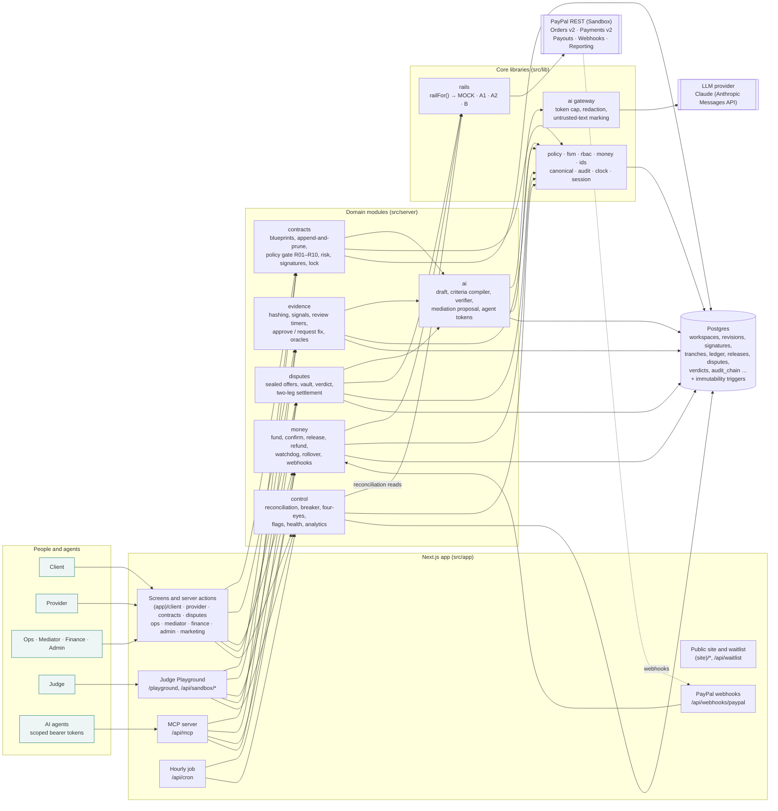

# PaySettle architecture

PaySettle is one Next.js 16 application (App Router, React 19, TypeScript strict) on Postgres 16 through Drizzle. Screens,
server actions, route handlers and background jobs live in the same deployable; domain logic sits in `src/server/<module>`
and talks to PayPal only through the rail interface in `src/lib/rails`.

## Modules and data flow



### A milestone, end to end

```mermaid
sequenceDiagram
  autonumber
  participant Cl as Client
  participant Pr as Provider
  participant PS as PaySettle
  participant PP as PayPal
  Cl->>PS: clone blueprint, negotiate (revisions), sign rev N + hash
  Pr->>PS: countersign rev N + same hash (R09)
  PS->>PS: lock → tranches within the hold window (risk ≥ 75 → Ops clears first)
  Cl->>PS: fund tranche 1
  PS->>PP: POST /v2/checkout/orders (intent AUTHORIZE, PayPal-Request-Id = idemKey)
  Cl->>PP: approve the order
  PS->>PP: POST /v2/checkout/orders/{id}/authorize → ledger HOLD
  Pr->>PS: submit evidence (files hashed to a root; signals computed)
  PS->>PS: AI verifier (advisory) + rule-based checks
  Cl->>PS: approve, signed over the evidence root hash (P4)
  PS->>PP: POST /v2/payments/authorizations/{id}/capture (partial capture of this milestone)
  PS->>PS: ledger RELEASE + FEE (integer cents, double entry)
  PP-->>PS: webhook PAYMENT.CAPTURE.COMPLETED → verified, de-duplicated
  Note over PS,PP: Hourly: reconciliation compares contract (A), ledger (B), PayPal (C); drift trips the tranche breaker
```

### Rails

| Rail | What it does | Where |
|---|---|---|
| MOCK | Deterministic in-memory PayPal stand-in; fault injection for the playground (503 on fund or release) | `src/lib/rails/mock.ts` |
| A1 | Order with the provider as payee; authorize, then partial captures per milestone | `src/lib/rails/paypal.ts` |
| A2 | Platform as payee, then Payouts; custodial, so refused in production | `src/lib/rails/paypal.ts` |
| B | Capture with delayed disbursement (behind the `rail.B` switch) | `src/lib/rails/paypal.ts` |

`railFor()` in `src/lib/rails/index.ts` chooses the rail: MOCK when no PayPal Sandbox credentials are set, otherwise the
contract's rail. Webhook signatures are checked through `/v1/notifications/verify-webhook-signature`
(`src/server/money/webhook.ts`).

### Clocks

Every deadline uses the workspace's virtual clock (`workspaceNow()` in `src/server/clock.ts`). The Judge Playground moves a
session's clock only (`src/server/playground/session.ts`); real time and real money are untouched.

## Constitution P1–P12 and where each is enforced

| # | Rule | Enforced in |
|---|---|---|
| P1 | Money moves only through `src/lib/rails` (`railFor`) | `src/lib/rails/index.ts`, `src/lib/rails/types.ts`; callers in `src/server/money/index.ts`, `src/server/disputes/index.ts`; rail A2 refuses production in `src/lib/rails/paypal.ts` |
| P2 | Every money call uses `idemKey(...)`, stored before the call | `src/lib/ids.ts` (`idemKey`); sent as `PayPal-Request-Id` in `src/lib/rails/paypal.ts`; retries reuse the key (`src/server/money/index.ts`); playground S5 proves one payout after a 503 |
| P3 | AI is advisory; AI code never writes contracts, ledger, signatures or releases | `src/server/ai/index.ts` returns proposals only; `src/server/ai/mcp.ts` `approve_release` records a pending approval (test `src/server/ai/mcp.test.ts` "P3 P4 A5 …"); UI labels in `src/components/evidence/AiPanel.tsx`. Enforced by code structure and tests; there is no separate database role with reduced grants for AI code |
| P4 | Every release needs a signed client approval or a mediator verdict | `src/server/money/index.ts` (release requires `approvalSig` or verdict); `src/server/evidence/index.ts` (approval signed over the root hash); `src/server/money/money.test.ts` |
| P5 | Sealed revisions and verdicts are immutable | Postgres triggers in `src/db/sql/guards.sql` (revisions, verdicts, ledger, audit chain, releases) applied by `npm run db:guards`; canonical hashing in `src/lib/canonical.ts`; `src/server/contracts/contracts.test.ts` |
| P6 | Integer cents and basis points only; double-entry ledger | `src/lib/money.ts` (+ `money.test.ts`); ledger writes in `src/server/money/index.ts`; reconciliation in `src/server/control/recon.ts` |
| P7 | Webhooks verified and de-duplicated | `src/app/api/webhooks/paypal/route.ts`, `src/server/money/webhook.ts` (+ `webhook.test.ts`); playground S5 posts a duplicate |
| P8 | No secrets in code | Configuration from environment only (`.env.example`, `src/lib/ai/config.ts`); secrets never logged; `tools/secret-scan.mjs` (`npm run gate:secrets`, CI, and the pre-commit hook in `.githooks/`) plus a gitleaks scan of the full history in CI |
| P9 | Sandbox-only features check `sandboxMode()` | `src/lib/clock.ts` (`sandboxMode`); demo sign-in `src/app/(auth)/login/actions.ts`; playground guard `src/app/api/sandbox/_guard.ts`; `src/server/playground/*` |
| P10 | No guarantee language | `tools/copy-lint.mjs` (`npm run gate:copy`, scans `src/app`, `src/components`, `src/copy`, `src/data`, `README.md`, `docs/`); `src/data/blueprints/blueprints.test.ts`; e2e `e2e/site.spec.ts` checks the landing page |
| P11 | Uploaded content is untrusted | `src/server/evidence/spec.ts`, `src/server/evidence/storage.ts` (type sniffing, HTML refused); `src/lib/ai/untrusted.ts` (text wrapped as data for the model); tests in `src/server/evidence/*.test.ts`, `src/lib/ai/gateway.test.ts` |
| P12 | Requirement ids in file headers and test names | `tools/traceability.ts` (`npm run gate:trace`) — every PRD id must appear in code and in a unit or e2e test |

## Security notes

- **Tenant isolation is enforced in application code, not by the database.** Every table carries `org_id`, and every
  read model and action filters by the signed-in person's organisation and role (`src/lib/rbac.ts`, `src/lib/session.ts`,
  the read models in `src/server/*`; role rules tested in `src/lib/rbac.test.ts`). Postgres row-level security is not
  enabled. Turning it on, with a per-request `app.org_id` setting and policies on each table, is planned before a pilot
  with real money.
- **Script rule (CSP with nonces).** `src/proxy.ts` gives every page a fresh nonce and sends
  `script-src 'self' 'nonce-…' 'strict-dynamic'` (`src/lib/csp-scripts.ts`). The two inline start-up scripts carry the
  nonce; any other inline script is refused. `CSP_SCRIPTS=report` only reports, and `CSP_SCRIPTS=off` leaves the rule out.
  The fixed page rules (frames, forms, `connect-src`, …) are in `next.config.ts`.
- **Rate limits** cover registration, social sign-in start and the waitlist (`src/lib/net.ts`). Other endpoints rely on
  sign-in, MFA and four-eyes rules.

## Tests and gates

| Gate | Command | Covers |
|---|---|---|
| Types | `npm run typecheck` | whole repository |
| Unit and integration | `npm test` (Vitest) | domain modules against a test database |
| Copy | `npm run gate:copy` | P10 |
| Lint | `npm run lint` | ESLint (Next.js core web vitals + TypeScript), no warnings allowed in CI |
| Name leak | `npm run gate:names` | names of the author's earlier projects (see `REUSE.md`), kept as hashes |
| Build vocabulary | `npm run gate:vocab` | no build-process ids in published files |
| Secrets | `npm run gate:secrets` | P8 |
| Dependencies | `npm audit --omit=dev --audit-level=high` (CI) | runtime advisories |
| Traceability | `npm run gate:trace` | P12 |
| End to end | `npm run test:e2e` (Playwright, `e2e/`) | persona sign-in and menus, playground S1/S2/S4/S5, client approval, provider, negotiation, mediator, finance, site, axe accessibility |
| AI evals | `npm run eval` (`evals/`) | criteria compiler, evidence verifier, mediation, prompt injection; needs an AI key |
